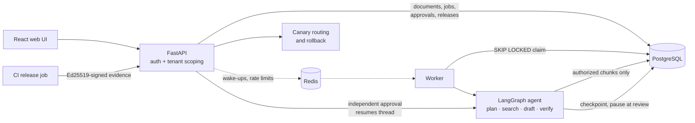

# Secure AI Engineering Platform


**Multi-tenant RAG and agent research with security built in.** Tenant-isolated retrieval, a LangGraph research agent that pauses for independent human review, signed model releases with canary rollback, and local PII redaction. It runs fully offline by default, with no API key needed.

*Final capstone of the Complete AI Engineer & Safe AI Engineering course (lessons 1–12).*

<details>
<summary>Earlier release-management screenshot</summary>


This screenshot predates the current green sidebar and guided demo.

</details>

> **Scope:** this project demonstrates specific engineering safeguards; it is not a production-certified system. The default answer mode **extracts passages** and does not call an LLM. The optional LLM writer (`MODEL_BACKEND=openai`) has been evaluated for faithfulness and prompt injection on synthetic data ([`docs/EVALUATION.md`](docs/EVALUATION.md)); evaluate again before using it on real private content.

## Why this project exists

An AI answer is useful only when the right person can access its evidence, understand its sources, and review the result. This capstone brings retrieval, research workflows, model evaluation, and release operations into one application, with explicit safeguards around each step.

| Workspace section | What you can do |
|---|---|
| Knowledge | Add documents, ask questions, and inspect source citations |
| Research | Run a task and send the resulting report for independent review |
| Quality | Evaluate labeled predictions and inspect subgroup performance |
| Releases | Verify signed evidence, start a canary, and promote or roll back a version |
| Incidents | Track problems through containment and resolution |

Available sections depend on your role and release-operator permissions.

## Results

| Measure | Result |
|---|---|
| Retrieval, 61 labeled questions (MiniLM hybrid) | Recall@3 **0.943**, MRR **0.929** |
| Cross-tenant leaks across all retrieval modes | **0** |
| Prompt-injection suite, offline writer and live `gpt-5.4-mini` | **0 of 30** attacks succeeded (each) |
| Live LLM answers, 61 questions (judge `gpt-5.5`, calibrated on 16 human labels) | Faithful **97%**, correct **100%**, declines unanswerable **96%** |
| Python tests, no external services or paid API calls | **182 passed**, 4 skipped (need PostgreSQL/Redis) |
| Frontend tests and production build | **23 passed**; TypeScript + Vite build passed |

Details and caveats: [`docs/EVALUATION.md`](docs/EVALUATION.md) and [`TEST_REPORT.md`](TEST_REPORT.md).

A separate [30-question holdout](benchmark/holdout/README.md), evaluated without retuning, achieved MiniLM hybrid Recall@3 **1.000**, abstention **0.667**, and **0** unauthorized retrievals. Its small synthetic corpus also gives BM25 perfect recall; it is an initial generalization check. [Saved results](artifacts/rag_holdout.md).

## Features

- **Tenant-isolated RAG.** Documents are filtered by tenant and group *before* any scoring. BM25, dense and hybrid (RRF) retrieval, with an approved `all-MiniLM-L6-v2` embedding model as an option.
- **Durable research agent.** LangGraph runs `plan → search → draft → verify → review`, checkpointed in PostgreSQL. The agent stops at review and resumes after restarts.
- **Independent human approval.** Approval is enforced in the database: the reviewer must be in the same tenant and cover the job's groups, and authors cannot approve their own work.
- **Signed model releases.** Before a canary starts, CI signs a benchmark report with Ed25519 and the server re-hashes the model file. Evidence rows can't be edited or deleted, enforced by database triggers.
- **Canary routing and rollback.** Users are assigned to a version and stay on it. High error rates roll the canary back automatically and open an incident.
- **Privacy.** PII is redacted on this machine before storage and before any outbound LLM call (regex by default, Presidio as an option).
- **Quality gates.** Precision, recall and F1 with Wilson intervals per group. The release is held if any subgroup fails, even when the overall average passes.
- **Prompt-injection suite.** 30 attacks in 7 categories run through the real upload, retrieval, worker and review paths. Tests confirm each defense is what stops its attacks.
- **Accounts.** Sign up with email and password or Google. Each account gets a private workspace. Passwords are hashed with scrypt, sessions are `HttpOnly` cookies that can be revoked, and Google sign-in uses the server-side OIDC flow with PKCE.
- **Web UI.** React + TypeScript workspace with green sidebar navigation, responsive layouts, system light/dark colors, keyboard focus indicators, and a redesigned sign-in screen. The nginx deployment serves it behind a strict Content-Security-Policy.
- **Guided demo.** Load fictional policies, try a suggested question, inspect citations, and open a real research task for independent review.
- **One-command development.** Start the frontend, API, and research worker together with `./scripts/dev.sh`; Ctrl+C stops all three.

More detail per feature: [`docs/FEATURES.md`](docs/FEATURES.md).

## Architecture



PostgreSQL holds the authoritative state. Redis only wakes workers up and enforces rate limits, so losing it delays work but never loses it. Full data flow, trust levels and failure model: [`docs/ARCHITECTURE.md`](docs/ARCHITECTURE.md).

## Quick start

Run these commands from the repository root. You need Python 3.11+, `uv`, and Node.js with npm. The local setup uses SQLite and runs without PostgreSQL, Redis, or an OpenAI API key.

### First-time setup

```bash
uv sync --extra test --extra production
(cd web && npm ci)
```

If you do not already have a `.env`, copy the example:

```bash
cp .env.example .env
```

Replace the example routing secret and demo bearer tokens in `.env`. Keep `MODEL_BACKEND=offline` for the extractive mode, which makes no paid model calls. Keep your existing `.env` when upgrading.

### Start everything

```bash
./scripts/dev.sh
```

| Service | Default address |
|---|---|
| Web app | http://127.0.0.1:5173 |
| API documentation | http://127.0.0.1:8000/docs |
| Readiness check | http://127.0.0.1:8000/health/ready |

The launcher loads the root `.env`, initializes `capstone.db`, starts the API, waits for readiness, then starts the research worker and frontend. Press **Ctrl+C** to stop everything. If executable permissions are unavailable, use `bash scripts/dev.sh`.

It uses SQLite, no Redis, and the offline graph by default, while preserving your configured `MODEL_BACKEND`. It sets the frontend proxy and public URL to match the selected ports.

| Optional setting | Purpose |
|---|---|
| `CAPSTONE_PORT` | API port; default `8000` |
| `CAPSTONE_DEV_WEB_PORT` | Local frontend port; default `5173` |
| `CAPSTONE_DEV_DATABASE_URL` | Override the local SQLite connection |
| `CAPSTONE_DEV_REDIS_URL` | Enable a local Redis connection |
| `CAPSTONE_DEV_GRAPH` | Select the local graph engine; default `offline` |

For example, if ports are occupied:

```bash
CAPSTONE_PORT=8002 CAPSTONE_DEV_WEB_PORT=5174 ./scripts/dev.sh
```

### Try the guided demo

1. Sign up for a private account, or expand **Use a development bearer token** to use a configured demo identity.
2. In **Knowledge**, find **Take your workspace for a spin**. Choose a group and select **Load sample documents**. An editor or admin can add the two fictional policies.
3. Select **Try the sample question**, then **Ask**. Read the answer and its source citations.
4. Select **Start demo research**. The app opens the real task in **Research**; the worker prepares its report.
5. For approval, sign in separately as an authorized reviewer in the same tenant with access to the task’s groups. Authors cannot approve their own reports. The example configuration includes separate author and reviewer identities; a newly registered one-person workspace has no independent reviewer.

Samples are stored through the normal API in your selected group. Nothing is uploaded automatically, and existing documents are preserved. Answers use your configured backend; OpenAI mode can incur API usage. Approval is internal sign-off and does not publish a report.

### Generate a standalone demo report

```bash
uv run python -m capstone.demo
```

Open `artifacts/dashboard.html` for a synthetic walkthrough of ingestion, retrieval, research review, model evaluation, canary rollout, and rollback.

Optional extras: `semantic` (approved embedding model), `privacy` (local Presidio detection), `llm` (OpenAI writer), and `documents` (PDF loading and text splitting). The semantic model needs cached weights in the default offline configuration.

### Run the API and worker manually

```bash
set -a; source .env; set +a
export DATABASE_URL=sqlite:///./capstone.db
export REDIS_URL=
export MODEL_BACKEND=offline
export CAPSTONE_GRAPH=offline
export CAPSTONE_PUBLIC_URL=http://127.0.0.1:5173
uv run python -m capstone.init_db
uv run uvicorn capstone.asgi:app --reload
```

In a second terminal, export the same environment and run `uv run python -m capstone.worker`. Start the frontend as described below. SQLite and the in-process rate limiter are intended for local learning and development.

### Run the full stack (Docker Compose)

```bash
cp .env.example .env
# Replace POSTGRES_PASSWORD, CAPSTONE_ROUTING_SECRET and EVERY demo bearer token.
docker compose up --build -d
docker compose logs -f api worker
```

| Service | Address |
|---|---|
| API docs | `http://127.0.0.1:${CAPSTONE_PORT:-8000}/docs` |
| Web UI | `http://127.0.0.1:${CAPSTONE_WEB_PORT:-8090}` |

Compose starts PostgreSQL, Redis, a schema initializer, the API, a separate LangGraph worker and the web UI. Only the API and UI are published, and only on `127.0.0.1`.

**Port already in use?** If another app owns port 8000, `localhost:8000` shows that app and `/health/ready` fails. Set `CAPSTONE_PORT=8002` (or any free port) in `.env`, then run `docker compose up -d --force-recreate api`. To see what owns a port: `lsof -nP -iTCP:8000 -sTCP:LISTEN`.

### Load demo data

Every tab starts empty on a fresh database. `capstone.seed` fills it through the public API, so redaction, independent review and signed release evidence all apply:

```bash
set -a; source .env; set +a
uv run python -m capstone.seed                                   # API on CAPSTONE_PORT (default 8000)
uv run python -m capstone.seed --base http://127.0.0.1:8002      # e.g. the Compose API on another port
```

It adds six policy documents plus another tenant's document you should never see, two research jobs (one approved), two incidents and, when a CI signing key and the MiniLM model are available, a baseline model with a 10% canary. Re-running it keeps existing data, and `--no-releases` skips the model steps.

### Web UI development

```bash
cd web
npm ci
VITE_API_TARGET=http://127.0.0.1:8000 npm run dev   # open http://127.0.0.1:5173
npm test
npm run build
```

Sign in with an account or a token from `CAPSTONE_TOKENS_JSON`. Google sign-in appears only when configured. Sign-in, token handling and the endpoints the UI uses: [`docs/WEB_UI.md`](docs/WEB_UI.md).

## Using the API

Step-by-step `curl` examples (upload, ask, submit a research job, review it, then register, evaluate and canary a model) are in [`docs/API_WALKTHROUGH.md`](docs/API_WALKTHROUGH.md). Release endpoints accept only identities from the tenant named in `CAPSTONE_RELEASE_TENANT`, and refuse everyone (403) when it is unset.

## Tech stack

| Component | Default (offline) | Full stack / optional |
|---|---|---|
| API | FastAPI with SQLite | FastAPI (Uvicorn container) with PostgreSQL |
| Retrieval | BM25 + deterministic hash vectors + RRF | Approved `all-MiniLM-L6-v2` embeddings (`semantic` extra), cached per chunk |
| Orchestration | Pure-Python equivalent of the graph | LangGraph `StateGraph` with durable `PostgresSaver` checkpoints |
| Worker | Database polling | PostgreSQL `SKIP LOCKED` claim + Redis wake-ups |
| Rate limiting | In-memory | Redis atomic Lua counter |
| Answers | Extractive passages, no LLM | Optional OpenAI writer, model ID approved per version |
| PII redaction | Local regex allowlist | Local Presidio NER (`privacy` extra) |
| Release evidence | Ed25519-signed CI report + artifact re-hash | Same; private key held only by the CI job |
| Telemetry | Prometheus counters and histograms | Optional OpenTelemetry instrumentation |
| Web UI | Vite dev server | nginx container with strict CSP |
| Deployment | Local Python | Docker Compose, GitHub Actions CI |

## Testing and verification

```bash
uv run pytest -q
(cd web && npm test && npm run build)
```

The combined launcher’s startup, frontend-to-API routing, and Ctrl+C cleanup were also smoke-tested locally. The redesigned screens and guided demo have automated interaction coverage; visual browser verification remains pending.

Set `TEST_POSTGRES_URL` and `TEST_REDIS_URL` to also run the infrastructure tests. Use a disposable test database: integration fixtures can reset its schema. CI provisions PostgreSQL and Redis, rejects missing or skipped required infrastructure checks, and retains pytest and holdout reports. The updated workflow still needs a GitHub run before its results can be claimed.

- **Verified:** authorization and cross-tenant isolation, job recovery and stale-worker fencing, release review and rollback, privacy checks, the real LangGraph runtime, and the full API + worker workflow on live PostgreSQL 16. Also, in Docker Compose: a research job resumed after restarting the containers, and a canary refused after the model file was swapped.
- **Recorded live evaluations:** the LLM writer against the 30-case injection suite and answer quality on 61 synthetic questions; see [`docs/EVALUATION.md`](docs/EVALUATION.md). These are saved results, not calls made by the offline test suite.
- **Not yet verified:** Redis runtime tests, the GitHub Actions workflow, Kubernetes, and distributed tracing export.

Local scores are not evidence of live RAG factuality, model safety, legal fairness or production security.

## Documentation

| Document | Contents |
|---|---|
| [`docs/ARCHITECTURE.md`](docs/ARCHITECTURE.md) | Data flow, trust levels, invariants, failure model |
| [`docs/FEATURES.md`](docs/FEATURES.md) | Full detail on retrieval, checkpoints, release evidence, privacy, injection suite |
| [`docs/API_WALKTHROUGH.md`](docs/API_WALKTHROUGH.md) | End-to-end `curl` examples |
| [`docs/WEB_UI.md`](docs/WEB_UI.md) | Web UI features, sign-in and security notes |
| [`docs/DEPLOYMENT.md`](docs/DEPLOYMENT.md) | Setup, keys, CI, rollout, backups, failure drills |
| [`docs/THREAT_MODEL.md`](docs/THREAT_MODEL.md) | STRIDE-based security analysis and control limits |
| [`docs/EVALUATION.md`](docs/EVALUATION.md) | Benchmark method and results |
| [`docs/FILE_BY_FILE.md`](docs/FILE_BY_FILE.md) | Walkthrough of every source, test and deployment file |
| [`docs/EXERCISES.md`](docs/EXERCISES.md) | Progressive coding challenges with worked answers |
| [`docs/PORTFOLIO.md`](docs/PORTFOLIO.md) | Demo script and talking points |
| [`TEST_REPORT.md`](TEST_REPORT.md) | Executed checks, bugs found and fixed, remaining skips |

## Roadmap

1. Move semantic vectors into a tenant-partitioned index (pgvector or similar), and tune on a development set before measuring a fresh, unseen evaluation set.
2. Derive canary telemetry from a trusted collector instead of operator input, and add model lineage and transparency-log signing for evidence.
3. Expand the live injection and claim-support evaluations with held-out cases and sign their results into release evidence.
4. Add Alembic migrations, replicated workers with lease heartbeats, an OIDC identity provider, encryption at rest and distributed tracing.
5. Add staged-environment release gates for PII, fairness, SLO/error budgets and rollback drills.

## Known limitations

- **Untrusted content.** Source passages may contain attacker-written instructions, quoted as evidence. Any client or LLM that consumes answers must treat them as untrusted; the bundled UI renders them as plain text.
- **PII.** Redaction reduces exposure but does not detect everything.
- **Retrieval.** The default embedding is a lexical hash baseline, and the semantic model is opt-in. Its development-benchmark similarity cutoff was tuned on that same set; the separate 30-question holdout was evaluated without retuning and has AI-assisted labels awaiting independent human review.
- **Releases.** Canary telemetry is operator-supplied, though release evidence is CI-signed. The re-hash at canary time doesn't stop the model file from being swapped later while it is serving. Signing keys are file-based, not stored in an HSM.
- **Operations.** The schema uses `create_all()`, not migrations. Static bearer tokens stand in for a real identity provider. Worker leases and fencing protect database results, but they can't make external model calls exactly-once.

## License

[MIT](LICENSE)
